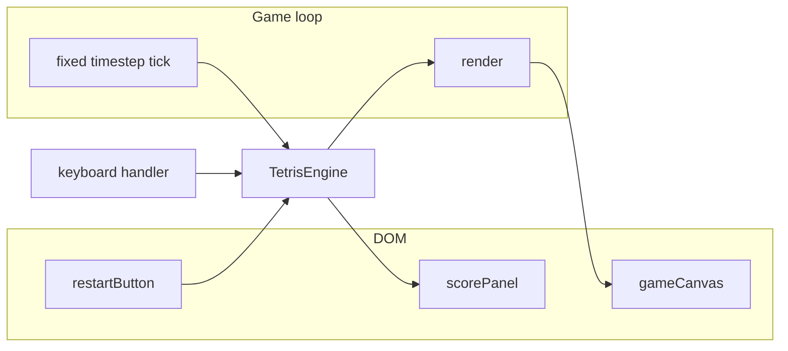

# HTML5 Tetris (vanilla) — implementation plan

## Goal

A single-page browser game you can open locally: **10×20 playfield** on Canvas, **arrow keys** to move/rotate, **Space** to hard-drop, **score/level/lines** on the **right**, and a **Restart** button that resets the board and stats.

## Architecture

**Core idea:** keep **game state** (grid, active piece, next piece, score, level, game-over flag) in one `TetrisEngine` class/object; **render** reads state only; **input** calls engine methods (`moveLeft`, `rotate`, `hardDrop`, etc.) with collision checks inside the engine.

## File layout

| File | Role |
|------|------|
| [`index.html`](index.html) | Page shell: canvas, side panel (score, level, lines, controls hint), restart button |
| [`css/style.css`](css/style.css) | Centered layout, dark theme, panel on the **right** of the board |
| [`js/constants.js`](js/constants.js) | Grid size, colors per piece type, timing, score tables |
| [`js/tetrominoes.js`](js/tetrominoes.js) | Shape definitions + rotation states (SRS-lite: 4 rotations per piece, wall kicks optional v1 = simple clamp/nudge) |
| [`js/engine.js`](js/engine.js) | Board, spawn, gravity, lock, line clear, scoring, level speed, game over, `reset()` |
| [`js/input.js`](js/input.js) | `keydown` listener; preventDefault on game keys; ignore repeat for rotate/hard-drop where needed |
| [`js/render.js`](js/render.js) | Draw grid, locked cells, ghost piece, active piece, optional grid lines |
| [`js/main.js`](js/main.js) | Wire engine + render + input; `requestAnimationFrame` loop with **accumulator** for gravity (e.g. drop every N ms based on level) |

No npm, no bundler — load scripts in order from `index.html`.

## Controls (as requested + standard Tetris)

| Key | Action |
|-----|--------|
| Left / Right | Move piece horizontally |
| Up | Rotate clockwise (document this in the side panel) |
| Down | Soft drop (faster fall + small score bonus per cell) |
| Space | Hard drop (instant lock to ghost position + bonus per cell) |

**Note:** You asked for arrows for “direction” and space to “drop”; **Up = rotate** is the usual complement so pieces are playable. It will be listed in the UI help text.

## Game rules (v1 — simple and recognizable)

- **Board:** 10 columns × 20 visible rows (plus 2 hidden rows at top for spawn).
- **Pieces:** standard 7 tetrominoes (I, O, T, S, Z, J, L), random bag or uniform random (prefer **7-bag** so droughts are rare — ~15 lines in `engine.js`).
- **Gravity:** piece falls one row every `dropIntervalMs(level)`; **Down** adds extra rows while held (with throttling).
- **Lock:** on landing, merge into grid; if spawn overlaps locked cells → **game over**.
- **Line clear:** full rows removed, rows above shift down; count lines cleared this lock for combo scoring.
- **Scoring (NES-style points, no build step):**

  - Single: 40 × (level + 1), Double: 100 × (level + 1), Triple: 300 × (level + 1), Tetris (4): 1200 × (level + 1)
  - Soft drop: +1 per cell, Hard drop: +2 per cell

- **Level:** +1 every 10 lines cleared; speed increases slightly each level (cap max speed so it stays playable).

## UI (right panel)

- **Score** (large)
- **Level**, **Lines cleared**
- Short **Controls** list
- **Restart** button → `engine.reset()` + clear any “Game Over” overlay on canvas
- Optional: show **Next piece** preview (small second canvas or drawn in panel — low effort, good polish)

## Rendering details

- Canvas internal resolution: e.g. `COLS * cellSize` × `ROWS * cellSize` (cellSize ~ 30px); CSS scales if needed.
- **Ghost piece:** show where hard drop would land (semi-transparent).
- **Game over:** overlay text on canvas + disable movement until Restart.

## Running locally

- Open [`index.html`](index.html) directly in a browser, **or** run a one-line static server from the project folder (e.g. `python3 -m http.server`) if you prefer — both work for this stack.

## Implementation order

1. **Constants + tetromino definitions** — verify rotations render correctly in a tiny debug log or first draw.
2. **Engine** — empty board, spawn, move/rotate with collision, gravity tick, lock, line clear, score/level, `reset()`.
3. **Render** — board + active + ghost; hook to engine state.
4. **Input** — map keys to engine; block default scrolling on Space/Arrows.
5. **HTML/CSS** — layout with panel on the right; wire Restart.
6. **Main loop** — fixed timestep gravity + render every frame.
7. **Manual playtest checklist** — wall collision, rotation at edges, line clear, score updates, restart mid-game and after game over.

## Out of scope for v1 (easy follow-ups later)

- Hold piece, pause, mobile touch, high scores in `localStorage`, sound, multiplayer

## Success criteria

- Playable Tetris in the browser with **arrow + space** controls
- **Score, level, and lines** update live on the **right**
- **Restart** fully resets game without reloading the page
- Code split into small readable files suitable for learning (comments only where logic is non-obvious, e.g. rotation matrices or bag shuffle)
